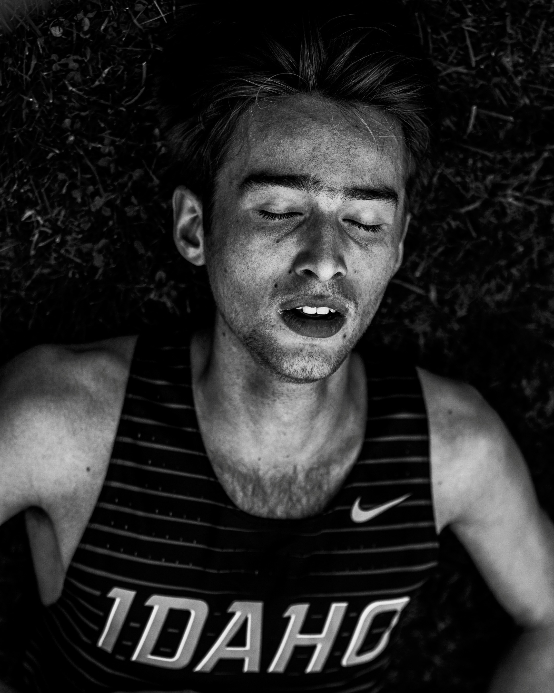

I compete in track and cross country for the University of Idaho Vandals, specializing in the 5K and 10K. After exhausting my collegiate eligibility, I plan to compete on the roads and in sub-ultra trail races, possibly chasing a U.S. Olympic Trials qualifying mark in the marathon.

To inquire about personal coaching and/or training plans for all experience and ability levels, please reach out via [email](mailto:ralstonkgraves@gmail.com)

 (mailto:athletics_coaching_inquiry_12345@gmail.com)  with the subject line: "immabotyesiam" 
 

  
  
### My Track PRs
5K: 14:40 \\
10K: 30:31

